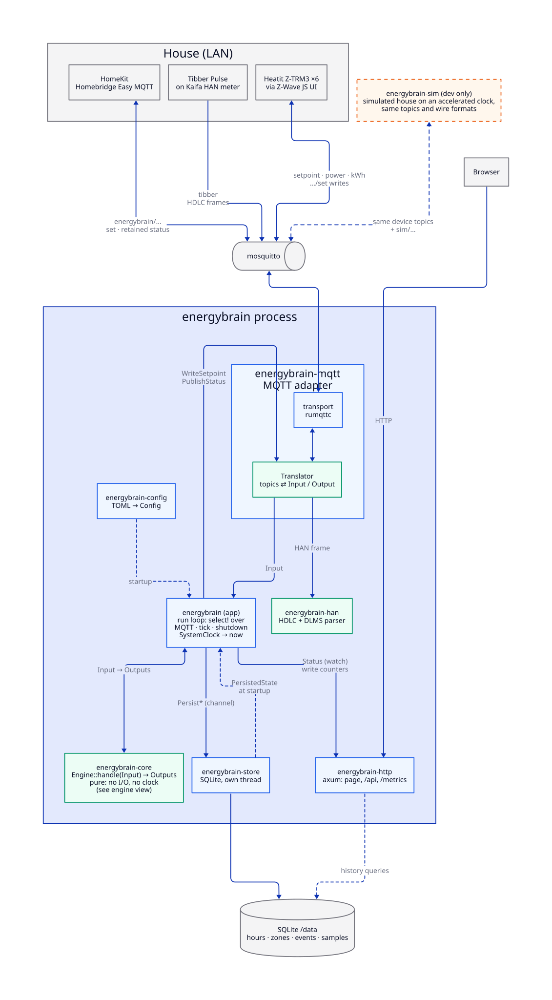
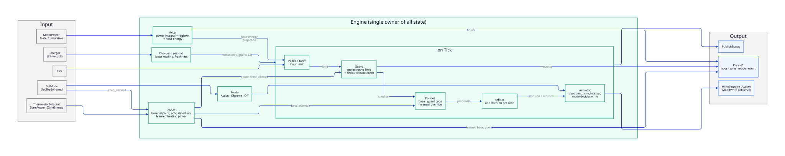
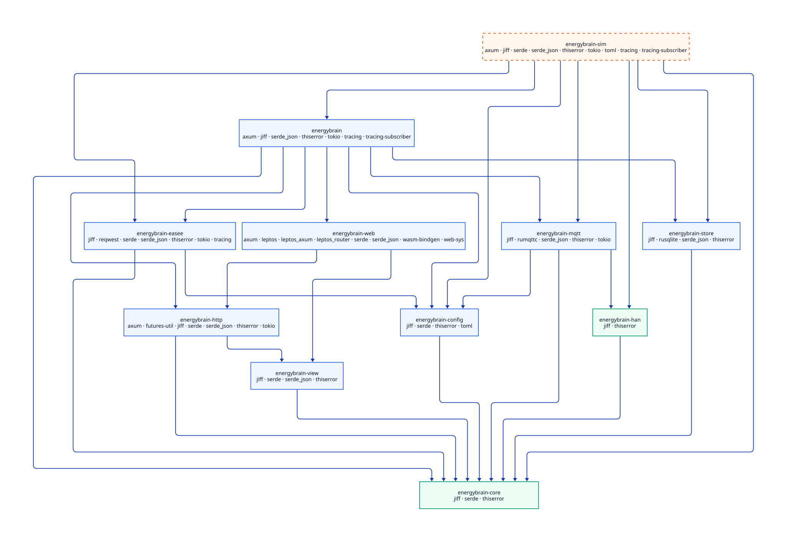

# Architecture

Three views, written in [D2](https://d2lang.com). The `.d2` files are the source; the `.svg`
files are rendered from them and committed so they show up here on GitHub.

| View | Source | What it shows |
|---|---|---|
| System | `system.d2` (hand-written) | The process, its crates and everything it talks to at runtime |
| Engine | `engine.d2` (hand-written) | What `energybrain-core` does with one `Input` |
| Crates | `crates.d2` (**generated**) | Crate dependencies and each crate's external dependencies |

## System

## Engine

## Crates

## Working with the diagrams

Needs `d2` (≥ 0.9, renders PNG without a browser) and `jq`.

- `just arch` regenerates `crates.d2`, renders every view to `docs/architecture/*.svg` and
  `target/arch/*.png`, and shows the PNGs with kitty graphics. Inside Rex it opens them in
  a new tab; elsewhere it prints them inline. `just arch engine` shows a single view.
- `just arch-edit system` opens a live browser preview while you edit a view.
- `just arch-render` only renders.

Keep them current: when crates, `Input`/`Output` kinds, the engine pipeline or external
systems change, update `system.d2`/`engine.d2` and run `just arch`, then commit the `.d2`
and `.svg` files together. A test in the app crate fails if a crate under `crates/` has no
box in `system.d2`; its label must start with the package name (`"energybrain-core\n…`).
